# UI elements

A visual reference of the elements described in [ui.md](ui.md). Snippets omit the surrounding
`inu.ui.settingsPage({ items: () => [...] })`; `noop` is `() => {}`.

## Header and separator

```ts
inu.ui.header('Header'),
inu.ui.button({ text: 'Button', onClick: noop }),
inu.ui.separator(),
inu.ui.header('Another section'),
inu.ui.button({ text: 'Button', onClick: noop }),
inu.ui.separator('Separator with a footer text, which can span several lines when it is long enough'),
```

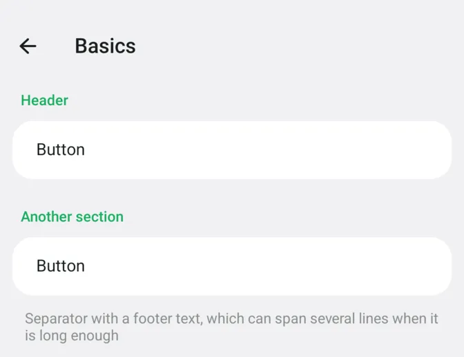

A `separator()` without text is just a gap between sections.

## Button

```ts
inu.ui.button({ text: 'Plain button', onClick: noop }),
inu.ui.button({ text: 'With an icon', icon: inu.icons.common('star'), onClick: noop }),
inu.ui.button({ text: 'With a subtitle', subtitle: 'Some extra details', icon: inu.icons.common('info'), onClick: noop }),
inu.ui.button({ text: 'With a value', value: '42', icon: inu.icons.common('settings'), onClick: noop }),
inu.ui.button({ text: 'Dangerous', icon: inu.icons.common('delete'), danger: true, onClick: noop }),
inu.ui.button({
  text: 'Multiline button with a long label that does not fit',
  subtitle: 'And a long subtitle that keeps going and wraps to the next line instead of being cut',
  multiline: true,
  icon: inu.icons.common('edit'),
  onClick: noop,
}),
```

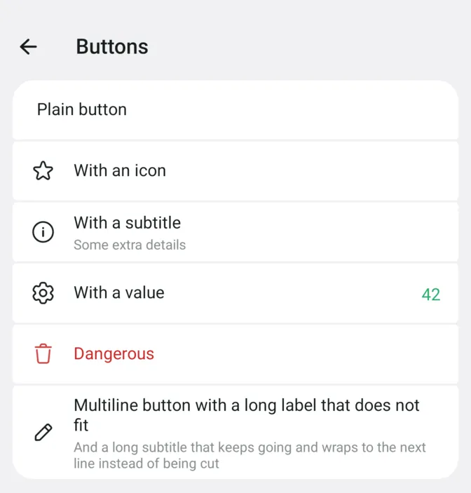

## Check

```ts
inu.ui.check({ text: 'Enabled', checked: true, onChange: noop }),
inu.ui.check({ text: 'Disabled', checked: false, onChange: noop }),
inu.ui.check({ text: 'With an icon', subtitle: 'And a subtitle', icon: inu.icons.common('eye'), checked: true, onChange: noop }),
// with `onClick`, the row is split: the body calls `onClick`, the switch calls `onChange`
inu.ui.check({
  text: 'Split row',
  subtitle: 'Body tap opens something else',
  icon: inu.icons.common('lock'),
  checked: true,
  onChange: noop,
  onClick: noop,
}),
```

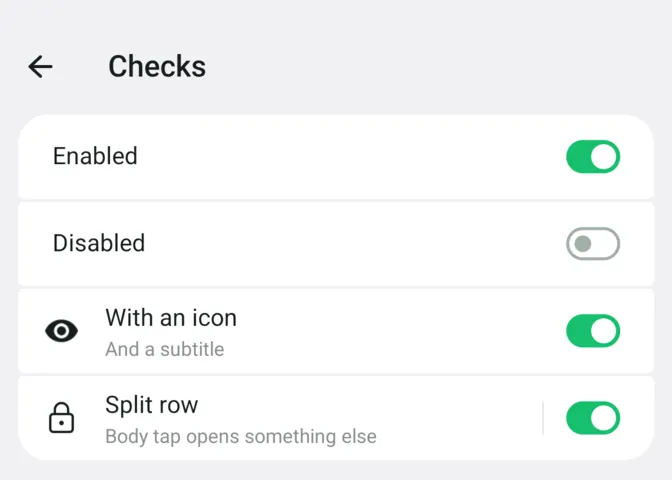

## Select

The selected item is shown as the row's value:

```ts
inu.ui.select({
  text: 'Mode',
  icon: inu.icons.common('settings'),
  items: ['Small', 'Medium', 'Large'],
  selected: 1,
  onChange: noop,
}),
inu.ui.select({
  text: 'Theme',
  icon: inu.icons.common('eye'),
  items: [
    { text: 'System', subtitle: 'Follow the system setting' },
    { text: 'Light', subtitle: 'Always light' },
    { text: 'Dark', subtitle: 'Always dark' },
  ],
  selected: 0,
  onChange: noop,
}),
```

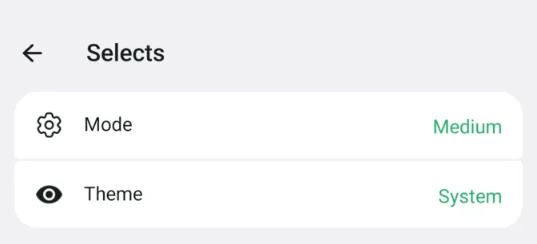

Plain items open a popup menu next to the row:

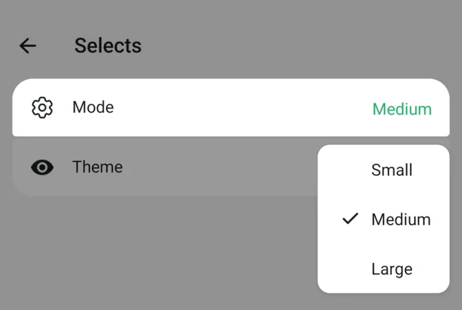

Items with subtitles (or `dialog: true`) open a dialog instead:

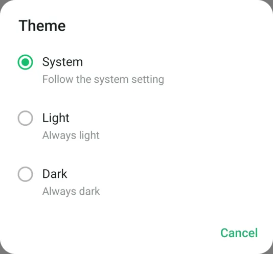

## Slider

```ts
inu.ui.slider({ text: 'Text size', min: 10, max: 30, step: 1, value: 14, default: 16, onChange: noop }),
inu.ui.separator(),
inu.ui.slider({ min: 0, max: 100, step: 5, value: 60, label: v => `${v}%`, onChange: noop }),
```

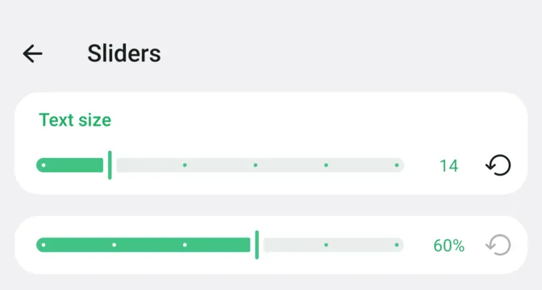

## Bottom button

```ts
inu.ui.settingsPage({
  title: 'Bottom button',
  items: () => [
    inu.ui.header('Account'),
    inu.ui.button({ text: 'Signed in as dog', icon: inu.icons.common('user'), onClick: noop }),
    inu.ui.separator(),
  ],
  bottomButton: { text: 'Save', onClick: noop },
})
```

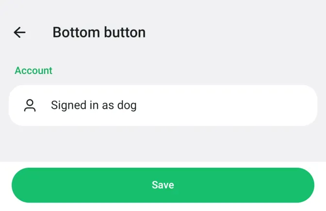

## Menu

```ts
inu.ui.button({
  text: 'Tap me',
  icon: inu.icons.common('more'),
  onClick: anchor => anchor.openMenu([
    { text: 'Pinned', checked: true, onClick: noop },
    { text: 'Muted', checked: false, onClick: noop },
    { text: 'Delete', danger: true, onClick: noop },
  ]),
}),
```

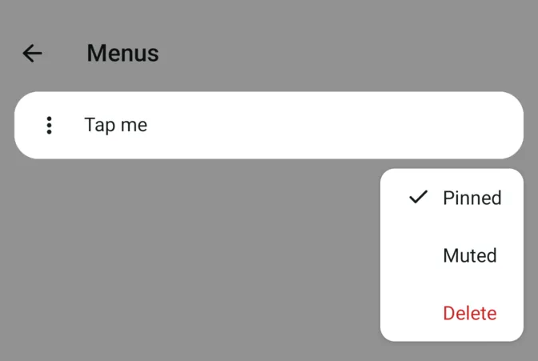

If any item has `checked` (even `false`), every row gets a checkmark column.

## Icons

```ts
inu.ui.button({ text: "common('bookmark')", icon: inu.icons.common('bookmark'), onClick: noop }),
inu.ui.button({ text: "animation('success')", icon: inu.icons.animation('success'), onClick: noop }),
inu.ui.button({ text: 'svg(...)', icon: inu.icons.svg(dogSvg), onClick: noop }),
inu.ui.button({ text: "resourceIcon('msg_message')", icon: inu.android.resourceIcon('msg_message'), onClick: noop }),
```

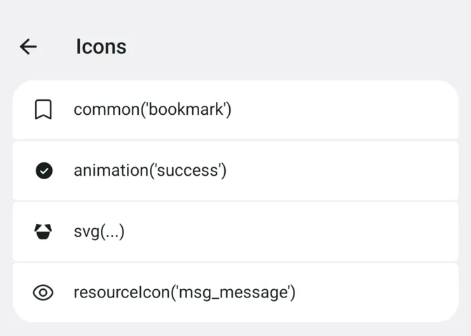

## Dialog

```ts
inu.ui.dialog({
  title: 'Delete everything?',
  message: 'This cannot be undone.',
  positive: 'Delete',
  negative: 'Cancel',
  neutral: 'Later',
})
```

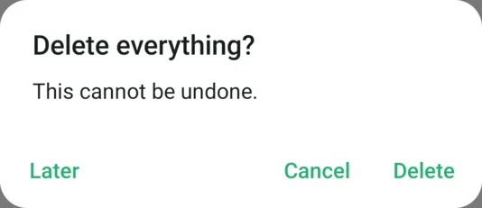

## Chooser

```ts
inu.ui.chooser({
  title: 'Pick a size',
  items: ['Small', 'Medium', { text: 'Large', subtitle: 'Takes more space' }, { text: 'None', danger: true }],
  selected: 1,
})
```

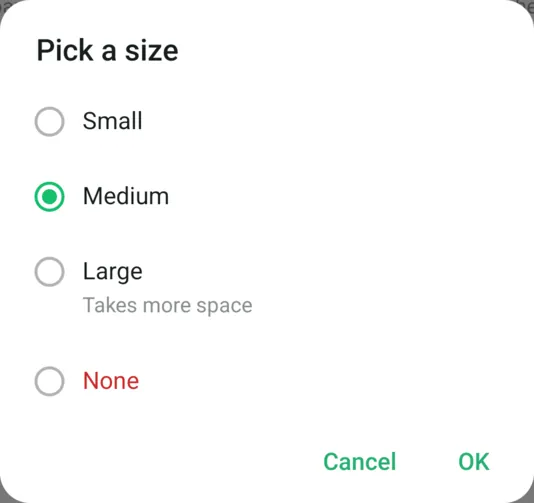

```ts
inu.ui.chooser({ title: 'Pick sizes', items: ['Small', 'Medium', 'Large'], selected: [0, 2], multiple: true })
```

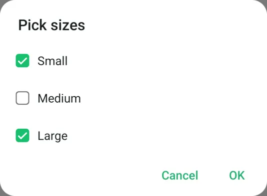

## Prompt

```ts
inu.ui.prompt({ title: 'Rename', hint: 'Name', value: 'dog' })
```

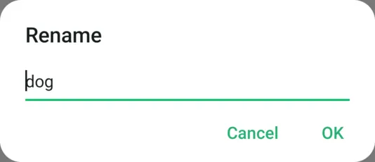

## Bulletin

```ts
inu.ui.bulletin({
  text: 'Saved',
  subtitle: 'Your changes are applied',
  icon: inu.icons.animation('success'),
  button: 'Undo',
})
```

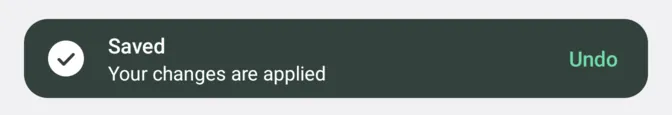

```ts
inu.ui.bulletin({ text: 'Copied to clipboard', icon: inu.icons.common('copy'), position: 'top' })
```

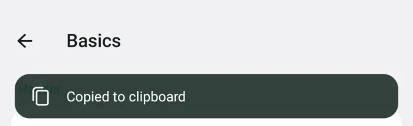
